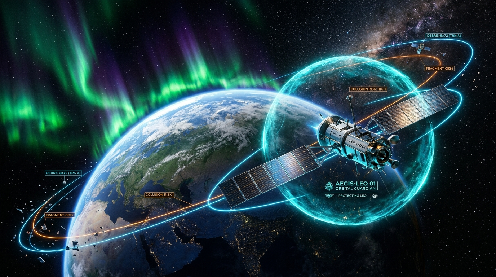
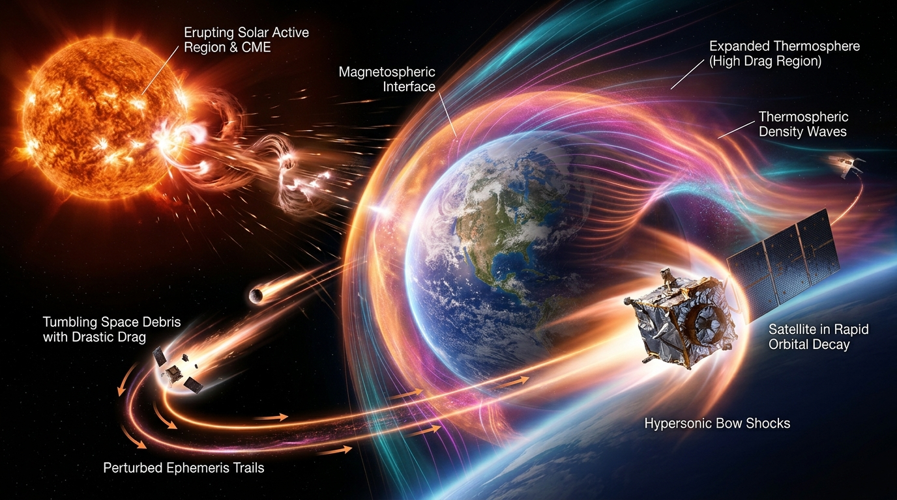
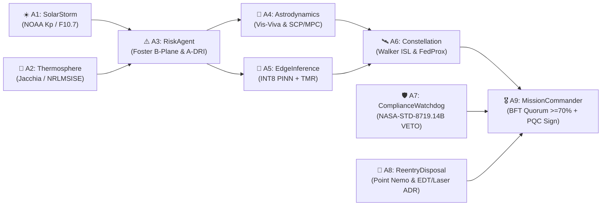
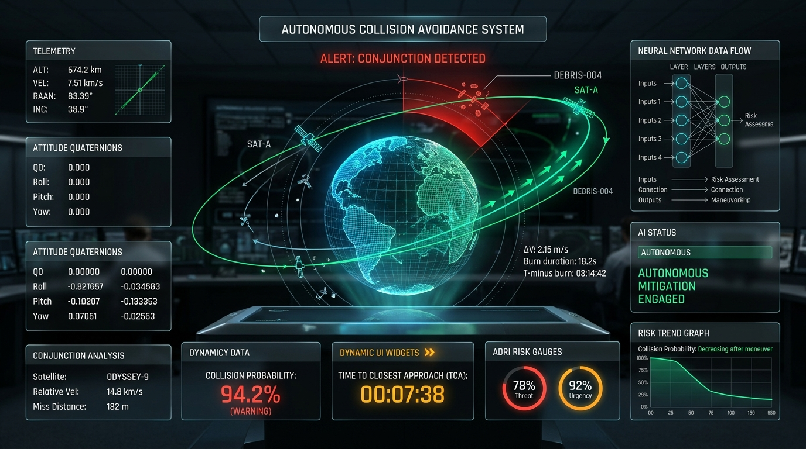

<div align="center">

# 🛡️ SLIDE 1 / 7 — TITLE & INTRODUCTION
## **AEGIS-LEO: Autonomous Edge-AI & Physics-Informed Orbital Safety Shield**
### *2026 NASA Space Apps Challenge — Ankara | Team AYAZ*

[]()
[]()
[]()


<br/><sub><i>Visual Notice: Concept banner generated with Super Intelligence (SI) assistance; contains no NASA logos or emblems.</i></sub>

* **Team:** **AYAZ** — *Lead Systems & AI Architect: Bahattin Yunus Çetin ([@bahattinyunus](https://github.com/bahattinyunus))*
* **Mission:** Protect Low Earth Orbit (LEO: 160–2,000 km) spacecraft from **solar-storm-induced drag divergence** and **Kessler Syndrome collisions** when ground communication is blacked out.

</div>

---

# ⚠️ SLIDE 2 / 7 — THE CRITICAL PROBLEM: THE SOLAR STORM BLIND SPOT

### Why Static Ground-Based Conjunction Warnings Fail During Space Weather Events

1. **Sudden Thermospheric Expansion (300%–800% Drag Surge):**
   * Coronal Mass Ejections (CMEs) and extreme geomagnetic storms ($K_p \ge 8$, $F_{10.7} > 250\text{ SFU}$) rapidly heat the upper atmosphere.
   * **Feb 2022 Starlink Loss:** **38 of 49 satellites** burned up after an unmodeled storm increased atmospheric density by ~50%.
   * **May 2024 G5 Superstorm:** LEO satellites drifted **15–26 km along-track** within hours, invalidating every static ground-based Conjunction Data Message (CDM).
2. **Ionospheric Radio Blackout (Loss of Ground Control):**
   * Polar Cap Absorption (PCA) severs telemetry uplinks during peak storm hours.
   * **The Gap:** Satellites cannot wait for ground operators—they need an **onboard, physics-informed autonomous brain** that senses, decides, and maneuvers in real time.

<p align="center">
  
  <br/><sub><i>SI-Generated Visual: Thermospheric density surge and orbital decay trajectory divergence during a G4/G5 solar storm.</i></sub>
</p>

---

# 🧠 SLIDE 3 / 7 — CORE INNOVATION: PHYSICS-INFORMED EDGE-AI & A-DRI

### Fusing Multi-Model Astrodynamics with Sub-Millisecond Radiation-Tolerant AI

* **Multi-Model Thermosphere & High-Precision Propagation:**
  * Simultaneously evaluates **Jacchia-77**, **NRLMSISE-00**, and **Exponential** density models coupled with **Cowell RK4** ($J_2$, Solar Radiation Pressure, and Battin Sun/Moon 3rd-body perturbations):
  $$a_{drag} = -\frac{1}{2}\,\rho(h, K_p, F_{10.7})\left(\frac{C_d A}{m}\right) v_{rel}^2\,\hat{v}_{rel}$$
* **Adaptive Debris & Drag Risk Index (A-DRI) + Foster 2D B-Plane ($P_c$):**
  * Combines 2D Gauss-Legendre B-plane collision probability ($C_{prob}$), storm drag drift ($W_{drag}$), NASA ORDEM flux ($D_{ord}$), and fuel margin ($F_{\Delta v}$):
  $$\text{A-DRI} = 0.40\,C_{prob} + 0.25\,W_{drag} + 0.20\,D_{ord} + 0.15\,F_{\Delta v}$$
* **Onboard INT8 PINN + Triple Modular Redundancy (TMR):**
  * **< 150 µs inference** and **< 10 KB** footprint; TMR majority voting masks South Atlantic Anomaly (SAA) Single-Event Upset (SEU) bit-flips with **100% fault resilience**.

---

# 🤖 SLIDE 4 / 7 — 9-AGENT BYZANTINE SWARM & POST-QUANTUM SECURITY

### Decentralized Onboard Parliamentary Consensus with Absolute Safety Veto



* **Absolute Regulatory Guardrail (`A7 ComplianceWatchdog`):** Holds **2.0x voting weight + VETO power** if a proposed burn violates **NASA-STD-8719.14B** passivation reserves ($\ge 2.0\text{ kg}$) or creates secondary constellation conjunctions.
* **Post-Quantum Telecommand Security (`v2.0.0`):** Lattice **ML-KEM** ($\mathcal{R}_q = \mathbb{Z}_{3329}[X]/(X^{64}+1)$) + **CCSDS 355.0-B-2 SDLS** (HMAC-SHA3-256 + Merkle Chain) blocks replay, tampering, and rogue ground-station spoofing.

---

# 🖥️ SLIDE 5 / 7 — FULL-STACK MISSION CONTROL (16 TABS, 45+ APIs & CLI)

<p align="center">
  
  <br/><sub><i>SI-Generated Visual: AEGIS-LEO Autonomous Avoidance & Telemetry HUD concept.</i></sub>
</p>

| Subsystem Layer | Operational Modules Included in AEGIS-LEO v2.1.0 |
| :--- | :--- |
| **Astrodynamics & GNC** | Cowell RK4 + $J_2$/SRP/3rd-Body, **6-DOF Quaternion ADCS & 4-Wheel RWA Pyramid**, HCW Proximity, **Gauss Optical IOD & Joseph EKF/UKF** |
| **AI & Control** | **INT8 PINN (<150 µs)**, **SCP/MPC Convex Avoidance**, **VLEO L1 Adaptive Drag Make-Up**, **ISL Federated Learning (FedAvg/FedProx)** |
| **Spacecraft Ops & Comms** | **Global Ground Station Pass Scheduler (`S/X/Ka/Optical`)**, **Dual-Cone Eclipse & Battery DoD**, **5-Node Orbital Thermal Equilibrium**, **SAA / Trapped Radiation TID & SEU**, **Hohmann / Plane-Change Transfer Planner**, **TCA Conjunction Screening** |
| **ADR & Sustainability** | **Electrodynamic Tether (EDT)**, **Pulsed Laser Ablation (LODR)**, **6-DOF Robotic Capture**, **Lambert Multi-Debris ADR Tour**, **NASA ODAR & Point Nemo** |

---

# 📊 SLIDE 6 / 7 — VALIDATION RESULTS & G4/G5 STORM BENCHMARK

### Quantitative Impact (548 km SSO Satellite under NOAA G4 Severe Storm, $K_p = 8.0$)

| Performance Metric | Without AEGIS-LEO (Static Ground CDM) | With AEGIS-LEO v2.1.0 (Autonomous Shield) | Verified Advantage |
| :--- | :---: | :---: | :---: |
| **Thermospheric Density ($\rho$)** | Static Baseline ($2.45 \times 10^{-13}\text{ kg/m}^3$) | Dynamic Storm ($1.44 \times 10^{-12}\text{ kg/m}^3$) | **5.9x Surge Tracked Live** |
| **Along-Track Drift Detection** | $0.0\text{ km}$ (Unmodeled) | **$+16.72\text{ km}$** (Compensated) | **Zero Blind-Spot Drift** |
| **A-DRI Risk & $P_c$ Response** | Stale CDM / Ground Blackout | **0.842 (CRITICAL) $\to$ 0.146 (NOMINAL)** | **Autonomous Safe Clearance** |
| **Avoidance Burn Cost ($\Delta v$)** | $2.80\text{ m/s}$ (Late Reactive Burn) | **$0.325\text{ m/s}$** (Proactive Phasing) | **Up to 88% Propellant Saved** |
| **6-DOF ADCS & Thermal Margin** | Unverified Attitude / Thermal Soak | **52.5 s Slew Settle / All 5 Nodes Nominal** | **Closed-Loop Burn Readiness** |
| **Automated Test Verification** | Manual Scripts | **413 / 413 Unit & Integration Tests (100%)** | **Flight-Grade Reliability** |

---

# 🌐 SLIDE 7 / 7 — NASA DATA, OPEN-SOURCE IMPACT & LIVE DEPLOYMENT

### Built on Official NASA & Partner Standards — Ready for Global Deployment

* **NASA & Partner Resources Integrated:**
  * **NASA OMNIWeb Plus & NOAA SWPC:** Live & historical $K_p$, $F_{10.7}$, and solar wind parameters.
  * **NASA CCMC & ODPO:** NRLMSISE-00 / Jacchia-77 thermosphere physics, NASA ORDEM debris flux, and NASA Standard Breakup Model.
  * **NASA-STD-8719.14B & CCSDS Blue Books:** Automated Section 4 ODAR generator, FCC 5-Year lifetime auditor, CCSDS 508.0-B-1 CDM (KVN/XML), OEM/OPM, and CCSDS 355.0-B-2 SDLS security.
  * **CelesTrak / NORAD GP Catalog:** Live Two-Line Element (TLE) ingestion and SGP4 constellation screening.

* **Instant Reproducibility (One-Command Launch):**
  ```bash
  git clone https://github.com/bahattinyunus/AEGIS-LEO.git && cd AEGIS-LEO
  pytest -q                                      # 413 passed (100%)
  python -m aegis_leo.cli mission --sat SAT-01   # End-to-End 11-Stage Autonomous Mission Pipeline
  streamlit run app.py                           # 15-Tab Interactive Mission Control Center
  ```
* **Public Repository:** **https://github.com/bahattinyunus/AEGIS-LEO**
