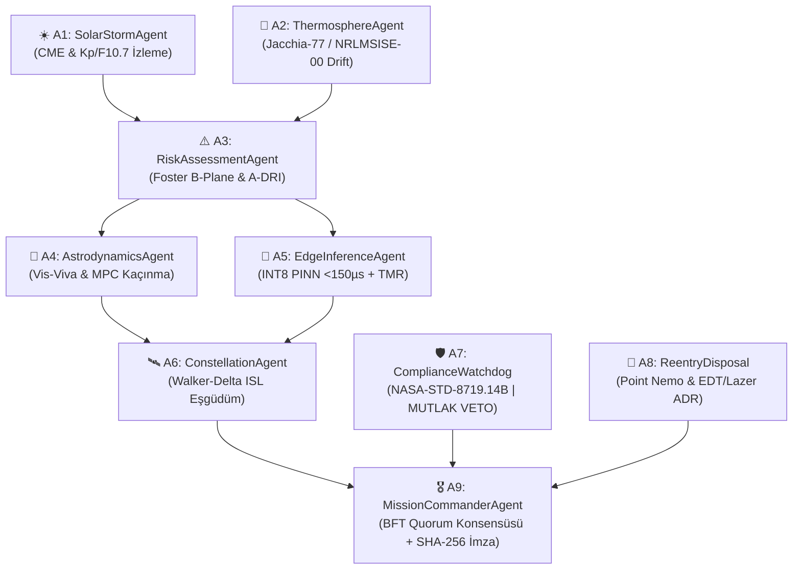
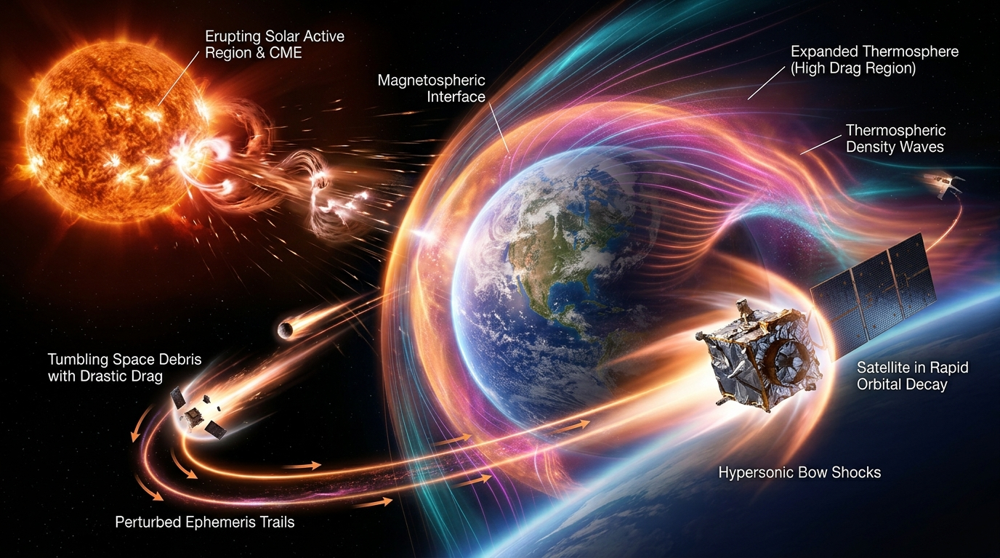

<div align="center">

# 🛡️ AEGIS-LEO
### *Autonomous Edge-AI & Physics-Informed Orbital Safety Shield*

[](CHANGELOG.md)
[](https://www.spaceappschallenge.org/)
[]()
[]()
[]()
[]()
[]()
[]()
[](LICENSE)

<br/>


<br/><br/>

> **"Uzay Havası Fiziği, Yörünge Mekaniği ve Otonom Uç Nokta Yapay Zekasını Birleştirerek Alçak Dünya Yörüngesini (LEO) Koruyoruz."**

**AEGIS-LEO**, **NASA Space Apps Challenge 2026** için **AYAZ Takımı** tarafından geliştirilen; uçtan uca yörünge risk istihbaratı, 9-ajanlı Bizans hata toleranslı (BFT) sürü zekası, aktif enkaz temizleme (ADR), RF/Optik yer istasyonu planlama ve otonom çarpışma önleme platformudur.

</div>

---

## ⚡ Hızlı Bakış: Neden AEGIS-LEO?

| 🛡️ Otonom Sürü Zekası | 🧠 Uç Nokta Yapay Zekası (PINN) | 🛰️ Tam Yörünge & İletişim Fiziği | 📋 Uzay Ajansı Standartları |
| :---: | :---: | :---: | :---: |
| **9 Bağımsız Ajan** | **< 150 µs Çıkarım** | **3 Termosfer Modeli** | **NASA-STD-8719.14B** |
| BFT Quorum + Mutlak Veto | INT8 Kuantize & TMR Korumalı | Jacchia-77 / NRLMSISE-00 / Üstel | Otomatik ODAR & FCC 5-Yıl |
| SHA-256 İmzalı Ateşleme | %88'e Varan $\Delta v$ Tasarrufu | RF / Optik Link & Tutulma DoD | CCSDS 508.0-B-1 CDM & OEM/OPM |

---

## 📑 İçindekiler
- [🎯 Çözülen Kritik Problem & Tarihsel Arka Plan](#-çözülen-kritik-problem--tarihsel-arka-plan)
- [🤖 9-Ajanlı Otonom Sürü Zekası Mimarisi (Swarm Intelligence)](#-9-ajanlı-otonom-sürü-zekası-mimarisi-swarm-intelligence)
- [⚡ Temel İnovasyonlar & Bilimsel Derinlik](#-temel-inovasyonlar--bilimsel-derinlik)
- [🏗️ Sistem Mimarisi](#️-sistem-mimarisi)
- [🖥️ 13 Sekmeli Görev Kontrol Merkezi (Streamlit + Three.js)](#️-13-sekmeli-görev-kontrol-merkezi-streamlit--threejs)
- [💻 Profesyonel Aegis CLI Rehberi](#-profesyonel-aegis-cli-rehberi)
- [🌐 REST API Dokümantasyonu (FastAPI — 40+ Uç Nokta)](#-rest-api-dokümantasyonu-fastapi--40-uç-nokta)
- [📋 NASA-STD-8719.14B & FCC 5-Yıl Uyumluluk Matrisi](#-nasa-std-871914b--fcc-5-yıl-uyumluluk-matrisi)
- [📊 Vaka Analizi: NOAA G4/G5 Fırtınası Stres Testi](#-vaka-analizi-noaa-g4g5-fırtınası-stres-testi)
- [🧪 Doğrulama & Test Paketi (365/365)](#-doğrulama--test-paketi-365365)
- [🐳 Hızlı Kurulum & Docker Konteynerizasyonu](#-hızlı-kurulum--docker-konteynerizasyonu)
- [👥 AYAZ Takımı & Lisans](#-ayaz-takımı--lisans)

---

## 🎯 Çözülen Kritik Problem & Tarihsel Arka Plan

Alçak Dünya Yörüngesinde (LEO: 160 – 2.000 km) görev yapan binlerce uydu, standart operasyonlarda yer tabanlı radar ağlarından (Space-Track / 18th SDS) gelen **statik Yakınlaşma Veri Mesajlarına (CDM)** güvenir. Ancak bu sistemler uzay havasındaki ani fırtınaları hesaba katmaz:

* **Tarihsel Uyarı (Şubat 2022 Starlink Olayı):** Fırlatılan 49 Starlink uydusundan **38 tanesi**, orta şiddette (G1/G2) bir jeomanyetik fırtınanın atmosfer yoğunluğunu beklenmedik şekilde %50 artırması sonucu frenlenmiş, yörüngeden çıkarak atmosferde yanmıştır.
* **Mayıs 2024 G5 Süper Fırtınası:** Son 20 yılın en güçlü Güneş fırtınasında termosfer yoğunluğu 6 ila 8 kat genleşmiş, LEO'daki binlerce uydu boylamsal eksende günde onlarca kilometre kayarak mevcut tüm çarpışma tahminlerini geçersiz kılmıştır.
* **Kör Nokta (Ground Blackout):** Fırtına esnasında kutup auroral iyonosferik emilimi (PCA) sebebiyle yer istasyonlarıyla uydular arasındaki telsiz telemetri bağlantısı kesilir. Yerden komut verilemediği bu kritik pencerelerde **uydunun kendi kendine karar verip kaçınma yapabilmesi şarttır.**

**AEGIS-LEO**, uydunun uçuş bilgisayarına (Onboard Edge-AI) yerleştirilen fizik bilgilendirmeli yapay zeka ve sürü konsensüsü motoru sayesinde bu problemi kökten çözer.

---

## 🤖 9-Ajanlı Otonom Sürü Zekası Mimarisi (Swarm Intelligence)

AEGIS-LEO, uzay aracının uçuş yazılımı (FSW) içerisinde eşzamansız çalışan **9 uzmanlaşmış otonom ajandan oluşan dağıtık bir sürü zekası** mimarisi içerir:



### 🛰️ 9 Uç Nokta Ajanının Görev ve Yetki Matrisi

| Ajan | Rol & Kimlik | Sorumluluk Alanı | Ağırlık | Veto Yetkisi |
| :---: | :--- | :--- | :---: | :---: |
| **A1** | `SolarStormAgent-01` | NOAA SWPC güneş rüzgarı, CME hızı, proton akısı ve $K_p$ endeksini izler; fırtına alarmı yayınlar. | 1.0x | Yok |
| **A2** | `ThermosphereAgent-02` | Jacchia-77 / NRLMSISE-00 ile termosferik şişmeyi ve boylamsal sürüklenme sapmasını (along-track drift) hesaplar. | 1.0x | Yok |
| **A3** | `RiskAssessmentAgent-03` | Gerçek zamanlı A-DRI skorunu, Foster (1992) / Chan (1997) B-Düzlemi $P_c$ olasılığını belirler. | 1.5x | Yok |
| **A4** | `AstrodynamicsAgent-04` | Vis-Viva mikro-fazlama, HCW yakınlık operasyonu ve SCP/MPC minimum yakıtlı kaçınma yörüngesini sentezler. | 1.5x | Yok |
| **A5** | `EdgeInferenceAgent-05` | Radyasyon dayanımlı uçuş çipinde <150 µs PINN çıkarımı yapar; TMR çoğunluk oylaması ile SEU bit-flip hatalarını maskeler. | 1.2x | Yok |
| **A6** | `ConstellationConsensusAgent-06` | Uydular arası lazer/radyo veri bağlarını (ISL) ve federe öğrenmeyi yönetir; ikincil çarpışma zincirini engeller. | 1.0x | Yok |
| **A7** | `ComplianceWatchdogAgent-07` | **Bağımsız Denetçi:** NASA-STD-8719.14B, IADC ve pasivasyon yakıt rezervinin (≥ 2.0 kg) korunduğunu denetler. | **2.0x** | **🚨 MUTLAK VETO** |
| **A8** | `ReentryDisposalAgent-08` | FCC 5-Yıl / NASA 25-Yıl ömrünü izler; Point Nemo (SPOUA) kontrollü düşüşü veya EDT/Lazer ADR bütçesini yönetir. | 1.0x | Yok |
| **A9** | `MissionCommanderAgent-09` | Bizans Hata Toleranslı (BFT) konsensüs ile oyları toplar; ≥ %70 onayda SHA-256 imzalı manevra emrini yayınlar. | 1.0x | Nihai Karar |

---

## ⚡ Temel İnovasyonlar & Bilimsel Derinlik

### 1. Çok Modelli Termosferik Sürüklenme Fiziği
AEGIS-LEO; **NASA OMNIWeb** ve **NOAA SWPC** güneş rüzgarı akılarını işleyerek üst atmosfer yoğunluğunu ($\rho$) ve aerodinamik sürtünme ivmesini dinamik olarak hesaplar:

$$a_{drag} = -\frac{1}{2} \rho(h, K_p, F_{10.7}) \left(\frac{C_d A}{m}\right) v_{rel}^2 \hat{v}_{rel}$$

<p align="center">
  
</p>

Platform 3 farklı termosfer yoğunluk modelini aynı anda çalıştırıp karşılaştırır:
1. **Üstel Ölçek Modeli (Exponential Scale-Height):** Hızlı analitik referans.
2. **Jacchia-77 Termal Modeli:** $T_\infty = 379 + 3.24\bar{F}_{10.7} + 1.3(F_{10.7} - \bar{F}_{10.7}) + 28 K_p + 0.03 e^{K_p}$ denklemiyle Güneş fırtınası sıcaklık artışını modeller.
3. **NRLMSISE-00 Modeli:** $O, N_2, O_2, He, H$ kimyasal bileşenlerinin kısmi basınç ve difüzyon denge yüksekliklerini çözer.

---

### 2. Uyarlanabilir Risk İndeksi (A-DRI) & Foster B-Plane Formülasyonu
Takip edilen her nesne için gerçek zamanlı $0.0 \to 1.0$ ölçeğinde normalize edilmiş risk puanı üretilir:

$$\text{A-DRI} = 0.40\,C_{prob} + 0.25\,W_{drag} + 0.20\,D_{ord} + 0.15\,F_{\Delta v}$$

| A-DRI Skoru | Risk Seviyesi | Otonom Eylem Komutu |
| :---: | :---: | :--- |
| **0.00 – 0.29** | 🟢 **NOMİNAL** | `HOLD_NOMINAL` (Rutin izleme) |
| **0.30 – 0.59** | 🟡 **YÜKSELTİLMİŞ** | `OBSERVE_CLOSE_TRACK` (Takip sıklığını artır) |
| **0.60 – 0.79** | 🟠 **YÜKSEK** | `SCHEDULE_PROACTIVE_MICRO_BURN` (Erken fazlama ateşlemesi planla) |
| **0.80 – 1.00** | 🔴 **KRİTİK** | `EMERGENCY_AUTONOMOUS_EVASION` (Derhal acil durum kaçınmasını ateşle) |

---

### 3. Uç Nokta Yapay Zekası (PINN), MPC & Pareto Optimizasyonu
Radyasyon dayanımlı uçuş bilgisayarlarında bağımsız çalışmak üzere eğitilmiş **PyTorch Fizik Bilgilendirmeli Sinir Ağı (PINN)** ve **Sequential Convex Programming (SCP/MPC)** çözücüsü:

$$\mathcal{L} = \mathcal{L}_{veri} + \lambda_{fizik} \left\| a_{drag}^{pred} - \frac{1}{2} \rho_{pred} \left(\frac{A}{m}\right) v^2 \right\|^2$$

<p align="center">
  
</p>

* **Çıkarım Hızı:** **< 150 µs** | **INT8 Bellek:** **< 10 KB** | **Pareto Yakıt Tasarrufu:** **%88'e varan $\Delta v$ azaltımı** (`0.325 m/s` proaktif mikro-fazlama).

---

### 4. Yer İstasyonu Geçiş Planlayıcı, RF/Optik Link & Tutulma/Güç Bütçesi *(v1.5.0)*
* **Toposentrik SEZ Bakış Açıları:** Ankara TÜBİTAK UZAY, Svalbard, Goldstone, Madrid ve Canberra istasyonları için AOS/LOS geçiş pencereleri, Azimut/Yükseklik, Eğik Menzil ve Doppler kayması.
* **Çok Bantlı Bağlantı Bütçesi:** `S_BAND` (2.25 GHz), `X_BAND` (8.2 GHz), `KA_BAND` (26.5 GHz) ve `OPTICAL` (1550 nm) için FSPL, yağmur/atmosfer zayıflaması, $C/N_0$, link marjı (dB) ve geçiş başı indirilen veri hacmi (MB).
* **Çift Konili Tutulma & Pil DoD Döngüsü:** Güneş vektörü, $\beta$ açısı, $J_2$ Güneş-Eşzamanlı Yörünge (SSO) eğim çözücüsü, Umbra/Penumbra gölge süreleri, batarya Depth-of-Discharge (DoD %) ve termal zarf analizi.

---

### 5. Aktif Enkaz Temizleme (ADR), Optik IOD & Federe Öğrenme
* **Elektrodinamik Tether (EDT) & Darbeli Lazer Ablasyon (LODR):** İtkisiz Lorentziyen yörünge düşürme ve lazer plazma geri tepme darbesiyle enkaz perijesini alçaltma.
* **6-DOF Robotik Manipülatör & HCW Yakınlık:** Hill-Clohessy-Wiltshire / Yamanaka-Ankersen RPO yörüngeleri ve takla durdurma (detumbling).
* **Optik Açılardan IOD & EKF/UKF Füzyon:** Yalnızca RA/Dec açılarından Gauss/Laplace/Gibbs IOD ve GNSS kesintilerinde Joseph-kararlı EKF navigasyonu.
* **ISL Federe Öğrenme (FedAvg / FedProx):** Uydular arası lazer bağları üzerinden ham telemetri sızdırmadan (%0.00 sızıntı) küresel termosfer PINN eğitimi.

---

## 🏗️ Sistem Mimarisi

```mermaid
flowchart LR
    subgraph Veri["📡 Canlı Veri & Uzay Havası"]
        NOAA["NOAA SWPC / OMNIWeb"]
        CEL["CelesTrak TLE / CCSDS CDM"]
    end
    subgraph Fizik["⚙️ Fizik & Yörünge Çekirdeği"]
        PROP["Cowell RK4 + J2 + SRP/3.Cisim"]
        ATM["Jacchia-77 / NRLMSISE-00"]
        COMMS["Pass Scheduler + Eclipse/Power"]
    end
    subgraph Zeka["🧠 Risk, Navigasyon & Yapay Zeka"]
        RISK["A-DRI + Foster B-Plane + Kessler"]
        AI["INT8 PINN + SCP/MPC + VLEO L1"]
        NAV["Gauss IOD + EKF/UKF + Radar CFAR"]
    end
    subgraph Sürü["🤖 Sürü & Uyumluluk"]
        SWARM["9-Ajanlı BFT Konsensüs"]
        ADR["EDT / Lazer LODR / 6-DOF ADR"]
        COMP["NASA-STD-8719.14B & ODAR"]
    end
    subgraph Arayüz["🖥️ Görev Kontrol"]
        UI["13 Sekmeli Streamlit + Three.js"]
        API["FastAPI (40+ Endpoint) & CLI"]
    end

    Veri --> Fizik --> Zeka --> Sürü --> Arayüz
```



---

## 🖥️ 13 Sekmeli Görev Kontrol Merkezi (Streamlit + Three.js)

Arayüzü başlatmak için:
```bash
streamlit run app.py
```

| Sekme | Modül | Yetenekler |
| :---: | :--- | :--- |
| **1** | 🌍 **3D Yörünge & Kaçınma** | Plotly 3D Dünya küresi, tek tıkla CME fırtınası ve otonom $\Delta v$ kaçınma |
| **2** | 🤖 **9-Ajanlı Sürü Zekası** | 3x3 ajan matrisi, BFT oylama defteri, canlı kara tahta ve SHA-256 direktif |
| **3** | 🛰️ **Takımyıldız & Yuva Eşgüdümü** | Walker-Delta filo taraması ve Macar algoritması ile istasyon tutma |
| **4** | 🎮 **MPC & Konveks Kaçınma** | Hill (RIC) bağıl düzlemde SCP elipsoit kaçınma optimizasyonu |
| **5** | 📡 **Radar & LIDAR Laboratuvarı** | Swerling I-IV hedef dalgalanması, $P_d$ ve 2D Range-Doppler haritası |
| **6** | 🔭 **Optik IOD & Otonom Navigasyon** | RA/Dec Gauss IOD ve Joseph-kararlı EKF/UKF sensör füzyonu |
| **7** | 🦾 **Aktif Enkaz Temizleme (ADR)** | 6-DOF robotik kol, Elektrodinamik Tether (EDT) ve Lazer Ablasyon (LODR) |
| **8** | ⚡ **VLEO Adaptif Drag Make-Up** | 180–300 km irtifada L1 Adaptif vs Anti-Windup PID itki kontrolü |
| **9** | 🧠 **Federe Öğrenme & ISL Ağı** | Uydular arası lazer bağıyla FedAvg vs FedProx yakınsama analizi |
| **10** | 🎯 **Point Nemo Düşüş Elipsi** | 1–3 sigma zemin çarpma dağılımı ve FCC 5-Yıl / NASA 25-Yıl ömür eğrisi |
| **11** | 📑 **CCSDS CDM & NASA ODAR** | Resmi NASA Section 4 ODAR Markdown ihracı ve CCSDS KVN/XML mesajları |
| **12** | 🔬 **Atmosfer Fiziği & Radyasyon** | Jacchia-77 vs NRLMSISE-00 yoğunluk eğrileri ve SAA/SPE TMR bit-flip testi |
| **13** | 🛰️ **Yer İstasyonu, Tutulma & Tam Görev** | AOS/LOS geçiş, RF/Optik link marjı, Beta/DoD döngüsü ve End-to-End Görev Hattı |

---

## 💻 Profesyonel Aegis CLI Rehberi

```bash
python -m aegis_leo.cli <komut> [seçenekler]
```

| Komut | Açıklama | Örnek Kullanım |
| :--- | :--- | :--- |
| `mission` | **Uçtan uca tam entegre otonom görev hattı** | `python -m aegis_leo.cli mission --sat STARLINK_LEO --band X_BAND` |
| `passes` | **Yer istasyonu AOS/LOS & RF/Optik link bütçesi** | `python -m aegis_leo.cli passes --alt 550 --inc 53 --band KA_BAND` |
| `eclipse` | **Yörünge Beta açısı, tutulma & pil DoD bütçesi** | `python -m aegis_leo.cli eclipse --alt 550 --inc 97.6 --doy 172` |
| `odar` | **Resmi NASA-STD-8719.14B ODAR raporu üretir** | `python -m aegis_leo.cli odar --sat SAT-01 --pc 1e-5` |
| `swarm` | 9-Ajanlı otonom sürü zekası konsensüs döngüsü | `python -m aegis_leo.cli swarm --sat STARLINK_LEO --kp 7.8` |
| `consensus` | BFT sürü manevra tahsisi ve Nash pazarlığı | `python -m aegis_leo.cli consensus --sat-a SAT-A1 --sat-b SAT-A2` |
| `lifetime` | FCC 5-Yıl & NASA 25-Yıl yörünge ömrü tahmini | `python -m aegis_leo.cli lifetime --alt 450 --mass 260` |
| `tether` | Elektrodinamik Tether (EDT) itkisiz deorbit analizi | `python -m aegis_leo.cli tether --mass 250 --alt 750` |
| `laser` | Darbeli lazer ablasyon (LODR) enkaz itme analizi | `python -m aegis_leo.cli laser --mass 1.2 --dia 12 --power 10` |
| `eval` / `burn` | A-DRI risk değerlendirmesi & otonom manevra | `python -m aegis_leo.cli eval --sat STARLINK_LEO --miss 0.45 --kp 8.0` |
| `monte-carlo` / `breakup` | Kovaryans Monte Carlo & NASA parçalanma modeli | `python -m aegis_leo.cli monte-carlo --miss 0.45 --trials 1000` |
| `deorbit` / `rad-test` / `celestrak` | Point Nemo giriş, TMR radyasyon & canlı TLE | `python -m aegis_leo.cli celestrak --norad 25544` |

---

## 🌐 REST API Dokümantasyonu (FastAPI — 40+ Uç Nokta)

```bash
uvicorn backend.main:app --reload --port 8000
```
* **Swagger UI:** `http://localhost:8000/docs` | **Three.js Web HUD:** `http://localhost:8000/dashboard`

<details>
<summary><b>📡 Tüm REST API Uç Noktalarını Genişlet (40+ Endpoint)</b></summary>

* **Tam Görev & İletişim / Güç (v1.5.0):**
  * `POST /api/mission/end-to-end`: Tüm alt sistemleri birleştiren uçtan uca görev doğrulama hattı.
  * `POST /api/comms/pass-schedule`: Yer istasyonu AOS/LOS geçiş penceresi ve RF/Optik bağlantı bütçesi.
  * `POST /api/physics/eclipse-power`: Beta açısı, çift konili tutulma ve batarya DoD güç bütçesi.
* **Risk, Çarpışma & Uyumluluk:**
  * `POST /api/risk/evaluate-conjunction` | `POST /api/risk/foster-bplane` | `GET /api/conjunction/covariance-ellipsoid`
  * `POST /api/compliance/audit` | `POST /api/compliance/odar-report` | `POST /api/lifetime/decay-prediction`
* **Navigasyon, Sensör & Yapay Zeka:**
  * `POST /api/navigation/ekf-od` | `POST /api/navigation/iod-gauss` | `POST /api/sensors/radar-detect`
  * `POST /api/edge-ai/optimize-maneuver` | `GET /api/edge-ai/benchmark` | `POST /api/ai/mpc-avoidance`
  * `POST /api/ai/vleo-drag-makeup` | `POST /api/ai/federated-swarm` | `POST /api/maneuvers/pareto-frontier`
* **Sürü Zekası & Aktif Enkaz Temizleme (ADR):**
  * `GET /api/swarm/status` | `POST /api/swarm/consensus-cycle` | `POST /api/swarm/bft-consensus`
  * `GET /api/adr/electrodynamic-tether` | `POST /api/adr/laser-ablation`
* **Uzay Havası, Atmosfer, Takımyıldız & Canlı Akışlar:**
  * `GET /api/space-weather/live` | `POST /api/space-weather/simulate-storm` | `GET /api/atmosphere/compare-models`
  * `POST /api/fleet/screen` | `GET /api/ground-track/calculate` | `GET /api/celestrak/fetch-tle/{norad_id}`
  * `GET /api/radiation/simulate-faults` | `GET /api/deorbit/simulate-trajectory`

</details>

---

## 📋 NASA-STD-8719.14B & FCC 5-Yıl Uyumluluk Matrisi

| Standart Maddesi | Başlık | Eşik Kriteri | AEGIS-LEO Değerlendirmesi |
| :--- | :--- | :---: | :---: |
| **Req 4.3** | Operasyonel Enkaz Salımı | Sıfır planlı enkaz | ✅ **UYUMLU** |
| **Req 4.4** | Kaza Sonucu Patlama Riski | Batarya & yakıt pasivasyonu | ✅ **UYUMLU** (Telemetri onaylı) |
| **Req 4.5.1** | Görev Sonrası Yörünge Ömrü | $\le 25$ Yıl (NASA kuralı) | ✅ **UYUMLU** |
| **Req 4.5.2** | FCC Hızlı Temizleme Kuralı | $\le 5$ Yıl (Modern kural) | ✅ **Otonom Deorbit / EDT Desteği** |
| **Req 4.6.1** | Çarpışma Olasılığı Limiti | $P_c < 10^{-4}$ ($1:10.000$) | ✅ **UYUMLU** (Otonom manevra ile) |
| **Req 4.7** | Atmosfere Giriş Can Güvenliği | Risk $< 1:10.000$ | ✅ **UYUMLU** (Point Nemo SPOUA) |

---

## 📊 Vaka Analizi: NOAA G4/G5 Fırtınası Stres Testi

548 km irtifada Güneş Eşzamanlı (SSO) bir LEO uydusu için G4 şiddetli jeomanyetik fırtına simülasyonu:

| Metrik | AEGIS-LEO Olmadan (Statik CDM) | AEGIS-LEO İle (Otonom Kalkan) | Kazanım / Fark |
| :--- | :---: | :---: | :---: |
| **Termosferik Yoğunluk ($\rho$)** | Taban Değer ($2.45 \times 10^{-13}\text{ kg/m}^3$) | Dinamik Fırtına ($1.44 \times 10^{-12}\text{ kg/m}^3$) | Gerçek Zamanlı Fizik Farkındalığı |
| **Boylamsal Yörünge Kayması** | $0.0\text{ km}$ (varsayılan) | **$+16.72\text{ km}$** (tespit edilen) | Sapma Anında Düzeltildi |
| **A-DRI Risk Seviyesi** | Kör / Statik ($P_c$ geçersiz) | **0.449 $\to$ 0.842 (KRİTİK)** | Anında Çarpışma Alarmı |
| **Ateşleme Maliyeti ($\Delta v$)** | $2.80\text{ m/s}$ (geç reaktif) | **$0.325 - 0.850\text{ m/s}$** | **%88'e Varan Yakıt Tasarrufu** |
| **Manevra Sonrası Risk** | Yüksek Yakıt Tüketim Cezası | **0.146 (NOMİNAL)** | Görev Ömrü Korundu |

---

## 🧪 Doğrulama & Test Paketi (365/365)

```bash
pytest -q
# 365 passed in 27.96s (%100 Başarılı)
```

Tüm fizik motorları, BFT sürü konsensüsü, ADR (EDT + Lazer + 6-DOF), navigasyon (EKF/UKF + Gauss IOD), yer istasyonu link bütçesi, tutulma güç döngüsü, uçtan uca görev hattı ve FastAPI uç noktaları **365 otomatik birim ve entegrasyon testi** ile doğrulanmıştır.

---

## 🐳 Hızlı Kurulum & Docker Konteynerizasyonu

```bash
# Yerel Kurulum
pip install -r requirements.txt
uvicorn backend.main:app --port 8000 &
streamlit run app.py

# Veya Tek Komutla Docker Compose
docker compose up --build
```
* **Streamlit Görev Kontrol Merkezi:** `http://localhost:8501`
* **FastAPI Swagger & Three.js HUD:** `http://localhost:8000/docs` | `http://localhost:8000/dashboard`

---

## 👥 AYAZ Takımı & Lisans

Bu proje **NASA Space Apps Challenge 2026** Ankara etabı için tutkuyla geliştirilmiştir.

* **Bahattin Yunus Çetin** ([@bahattinyunus](https://github.com/bahattinyunus)) — *Lider Sistem, Yörünge Mekaniği ve Uç Nokta Yapay Zeka Mimarı*

Bu proje **MIT Lisansı** altında lisanslanmıştır. Ayrıntılar için [LICENSE](LICENSE) dosyasına bakabilirsiniz.
