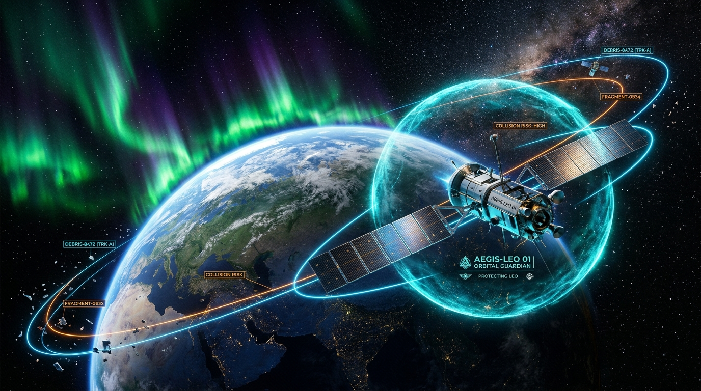
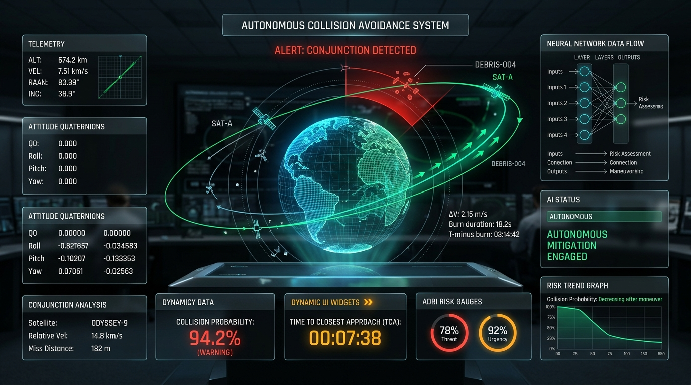

# 🛡️ AEGIS-LEO: Otonom Uç Nokta Yapay Zekası ve Fizik Bilgilendirmeli Yörünge Güvenlik Kalkanı

[](https://www.spaceappschallenge.org/)
[]()
[]()
[]()
[]()
[]()
[]()
[](https://opensource.org/licenses/MIT)

<p align="center">
  
</p>

> **"Uzay Havası Fiziği, Yörünge Mekaniği ve Otonom Uç Nokta Yapay Zekasını Birleştirerek Alçak Dünya Yörüngesini (LEO) Koruyoruz."**

**AEGIS-LEO** (*Autonomous Edge-AI & Physics-Informed Orbital Safety Shield*), **NASA Space Apps Challenge 2026** için **AYAZ Takımı** tarafından geliştirilen uçtan uca yörünge risk istihbaratı, takımyıldız taraması ve otonom çarpışma önleme platformudur.

Platform; **Güneş fırtınalarının (CME) tetiklediği ani termosferik genleşmeyi**, uydularda oluşan öngörülemeyen boylamsal yörünge kaymalarını (along-track drift), statik Yakınlaşma Veri Mesajlarının (CDM) geçersiz kalmasını ve Kessler Sendromu riskini çözmek için uzay ajansı seviyesinde (NASA/ESA/CCSDS) mühendislik altyapısı sunar.

---

## 📑 İçindekiler
- [🎯 Çözülen Kritik Problem & Tarihsel Arka Plan](#-çözülen-kritik-problem--tarihsel-arka-plan)
- [⚡ Temel İnovasyonlar & Bilimsel Derinlik](#-temel-inovasyonlar--bilimsel-derinlik)
  - [1. Çok Modelli Termosferik Sürüklenme Fiziği](#1-çok-modelli-termosferik-sürüklenme-fiziği)
  - [2. Uyarlanabilir Risk İndeksi (A-DRI) Formülasyonu](#2-uyarlanabilir-risk-indeksi-a-dri-formülasyonu)
  - [3. Uç Nokta Yapay Zekası & Pareto Manevra Optimizasyonu](#3-uç-nokta-yapay-zekası--pareto-manevra-optimizasyonu)
  - [4. Walker Delta Takımyıldız & Enkaz Taraması](#4-walker-delta-takımyıldız--enkaz-taraması)
  - [5. Yer İstasyonları & İletişim Kesintisi (Blackout)](#5-yer-istasyonları--iletişim-kesintisi-blackout)
- [🏗️ Sistem Mimarisi](#️-sistem-mimarisi)
- [🖥️ 5 Sekmeli Görev Kontrol Simülatörü](#️-5-sekmeli-görev-kontrol-simülatörü)
- [💻 Profesyonel Aegis CLI Rehberi](#-profesyonel-aegis-cli-rehberi)
- [🌐 REST API Dokümantasyonu (FastAPI)](#-rest-api-dokümantasyonu-fastapi)
- [📋 NASA-STD-8719.14 Uyumluluk Matrisi](#-nasa-std-871914-uyumluluk-matrisi)
- [📊 Vaka Analizi: NOAA G4/G5 Fırtınası Stres Testi](#-vaka-analizi-noaa-g4g5-fırtınası-stres-testi)
- [🧪 Doğrulama & Test Paketi](#-doğrulama--test-paketi)
- [🐳 Docker Konteynerizasyonu](#-docker-konteynerizasyonu)
- [👥 AYAZ Takımı & Lisans](#-ayaz-takımı--lisans)

---

## 🎯 Çözülen Kritik Problem & Tarihsel Arka Plan

Alçak Dünya Yörüngesinde (LEO: 160 – 2.000 km) görev yapan binlerce uydu, standart operasyonlarda yer tabanlı radar ağlarından (Space-Track / 18th SDS) gelen **statik Yakınlaşma Veri Mesajlarına (CDM)** güvenir. Ancak bu sistemler uzay havasındaki ani fırtınaları hesaba katmaz:

* **Tarihsel Uyarı (Şubat 2022 Starlink Olayı):** Fırlatılan 49 Starlink uydusundan **38 tanesi**, orta şiddette (G1/G2) bir jeomanyetik fırtınanın atmosfer yoğunluğunu beklenmedik şekilde %50 artırması sonucu frenlenmiş, yörüngeden çıkarak atmosferde yanmıştır.
* **Mayıs 2024 G5 Süper Fırtınası:** Son 20 yılın en güçlü Güneş fırtınasında termosfer yoğunluğu 6 ila 8 kat genleşmiş, LEO'daki binlerce uydu boylamsal eksende günde onlarca kilometre kayarak mevcut tüm çarpışma tahminlerini geçersiz kılmıştır.
* **Kör Nokta:** Fırtına esnasında kutup auroral iyonosferik emilimi (PCA) sebebiyle yer istasyonlarıyla uydular arasındaki telsiz telemetri bağlantısı kesilmektedir. Yerden komut verilemediği bu kritik pencerelerde, **uydunun kendi kendine karar verip kaçınma yapabilmesi şarttır.**

**AEGIS-LEO**, uydunun uçuş bilgisayarına (Onboard Edge-AI) yerleştirilen yapay zeka ve fizik motoru sayesinde bu problemi kökten çözer.

---

## ⚡ Temel İnovasyonlar & Bilimsel Derinlik

### 1. Çok Modelli Termosferik Sürüklenme Fiziği
AEGIS-LEO; **NASA OMNIWeb** ve **NOAA SWPC** güneş rüzgarı akılarını işleyerek üst atmosfer yoğunluğunu ($\rho$) ve aerodinamik sürtünme ivmesini dinamik olarak hesaplar:

$$a_{drag} = -\frac{1}{2} \rho(h, K_p, F_{10.7}) \left(\frac{C_d A}{m}\right) v_{rel}^2 \hat{v}_{rel}$$

<p align="center">
  
</p>

Platform 3 farklı termosfer yoğunluk modelini aynı anda çalıştırıp karşılaştırabilir:
1. **Üstel Ölçek Modeli (Exponential Scale-Height):** Hızlı analitik referans.
2. **Jacchia-77 Termal Modeli:** $T_\infty = 379 + 3.24\bar{F}_{10.7} + 1.3(F_{10.7} - \bar{F}_{10.7}) + 28 K_p + 0.03 e^{K_p}$ denklemiyle Güneş fırtınası sıcaklık artışını ve atmosfer şişmesini modeller.
3. **NRLMSISE-00 Modeli:** $O, N_2, O_2, He, H$ kimyasal bileşenlerinin kısmi basınç ve difüzyon denge yüksekliklerini irtifaya göre çözer.

---

### 2. Uyarlanabilir Risk İndeksi (A-DRI) Formülasyonu
Takip edilen her nesne için gerçek zamanlı $0.0 \to 1.0$ ölçeğinde normalize edilmiş risk puanı üretilir:

$$\text{A-DRI} = w_1 C_{prob} + w_2 W_{drag} + w_3 D_{ord} + w_4 F_{\Delta v}$$

```text
┌────────────────────────────────────────────────────────────────────────────┐
│ A-DRI BİLEŞENLERİ VE AĞIRLIK DAĞILIMI                                     │
├────────────────────────────────────────────────────────────────────────────┤
│ • C_prob (0.40): 3D-2D B-Düzlemi Gauss Kovaryans Çarpışma Olasılığı        │
│ • W_drag (0.25): Alan/Kütle Oranı (A/m) & Güneş Fırtınası Sürüklenme Sapması│
│ • D_ord  (0.20): NASA ORDEM 3.1 İrtifa/Eğim Mekânsal Enkaz Yoğunluk Modeli│
│ • F_Δv   (0.15): Kalan Yakıt Marjı ve Geç Manevra Maliyet Cezası           │
└────────────────────────────────────────────────────────────────────────────┘
```

| A-DRI Skoru | Risk Seviyesi | Otonom Eylem Komutu |
| :---: | :---: | :--- |
| **0.00 – 0.29** | 🟢 **NOMİNAL** | `HOLD_NOMINAL` (Rutin izleme) |
| **0.30 – 0.59** | 🟡 **YÜKSELTİLMİŞ** | `OBSERVE_CLOSE_TRACK` (Takip sıklığını artır) |
| **0.60 – 0.79** | 🟠 **YÜKSEK** | `SCHEDULE_PROACTIVE_MICRO_BURN` (Erken fazlama ateşlemesi planla) |
| **0.80 – 1.00** | 🔴 **KRİTİK** | `EMERGENCY_AUTONOMOUS_EVASION` (Derhal acil durum kaçınmasını ateşle) |

---

### 3. Uç Nokta Yapay Zekası & Pareto Manevra Optimizasyonu
Radyasyon dayanımlı uçuş bilgisayarlarında (NVIDIA Jetson / Onboard RT-OBC) bağımsız çalışmak üzere eğitilmiş **PyTorch Fizik Bilgilendirmeli Sinir Ağı (PINN)**:

$$\mathcal{L} = \mathcal{L}_{veri} + \lambda_{fizik} \left\| a_{drag}^{pred} - \frac{1}{2} \rho_{pred} \left(\frac{A}{m}\right) v^2 \right\|^2$$

* **Çıkarım Hızı:** **< 150 mikrosaniye** gecikme süresi.
* **Bellek Alanı:** **< 10 KB** INT8 kuantize model boyutu.

<p align="center">
  
</p>

**Çok Amaçlı Pareto Frontier:** Tek tip kör ateşleme yerine üç yönlü optimum çözümler üretir:
* **Minimum Yakıt:** $\Delta v = 0.325\text{ m/s}$ mikro-fazlama ile %88 yakıt tasarrufu.
* **Dengeli Optimum:** Yakıt maliyeti, karşılaşma mesafesi ve ikincil enkaz riski arasında altın oran.
* **Maksimum Güvenlik:** Derin orbital irtifa yükseltme manevrası.

---

### 4. Walker Delta Takımyıldız & Enkaz Taraması
* 24 ila 72 uyduluk takımyıldız filolarını (Starlink, OneWeb mimarisi) yüzlerce orbital enkaz parçasına karşı $\pm 15\text{ km}$ mekânsal irtifa kapısı ile saniyeler içinde tarar.
* Filo çapında anlık risk dağılımı (Kritik, Yüksek, Nominal) üretir.

---

### 5. Yer İstasyonları & İletişim Kesintisi (Blackout)
* **Ankara TÜBİTAK UZAY**, Svalbard (Norveç), Goldstone (ABD), Madrid (İspanya) ve Canberra (Avustralya) yer istasyonlarının görüş pencerelerini hesaplar.
* $K_p \ge 7$ fırtınalarında oluşan kutup radyo kesintilerini (Polar Cap Absorption) modelleyerek yer istasyonundan bağımsız **Uç Nokta Otonomisinin** zorunluluğunu kanıtlar.

---

## 🏗️ Sistem Mimarisi

```text
┌─────────────────────────────────┐        ┌─────────────────────────────────┐
│     NASA OMNIWeb / NOAA SWPC    │        │      Space-Track TLE / CDM      │
│  (Güneş Rüzgarı, Kp, F10.7, Ap) │        │   (Yörünge Konumu & Kovaryans)  │
└────────────────┬────────────────┘        └────────────────┬────────────────┘
                 │                                          │
                 ▼                                          ▼
┌────────────────────────────────────────────────────────────────────────────┐
│               Fizik Bilgilendirmeli Yörünge & Sürüklenme Motoru            │
│  • Cowell RK4 Sayısal İntegratörü  • J2 Yerçekimi Basıklık Modeli          │
│  • Çok Modelli Termosfer: Üstel, Jacchia-77, NRLMSISE-00 Çözücüleri        │
│  • Sonlu Süreli Motor İtki ve Kütle Tüketim Entegratörü (Maneuver Splicer) │
└─────────────────────────────────────┬──────────────────────────────────────┘
                                      │
                                      ▼
┌────────────────────────────────────────────────────────────────────────────┐
│                    A-DRI Risk Motoru & Uç Nokta Optimize Edici             │
│  • 3D-2D B-Düzlemi Kovaryans İzdüşümü ve Monte Carlo Doğrulayıcısı         │
│  • Çok Amaçlı Pareto Frontier Manevra Optimize Edicisi                     │
│  • Uçuş Bilgisayarı PINN Yapay Zeka Çekirdeği (< 150 µs, INT8 Hazır)       │
└─────────────────────────────────────┬──────────────────────────────────────┘
                                      │
                 ┌────────────────────┴────────────────────┐
                 ▼                                         ▼
┌─────────────────────────────────┐       ┌─────────────────────────────────┐
│   5 Sekmeli İnteraktif Görev    │       │   NASA-STD-8719.14 Uyumluluk    │
│  Kontrol (Streamlit + FastAPI)  │       │   Otomatik Denetim & ODAR Raporu│
│  • 3D Yörünge Küresi            │       │   CCSDS OEM / OPM Ephemeris     │
│  • Walker Delta Filo Taraması   │       │   NASA Standart Breakup Modeli  │
│  • TÜBİTAK UZAY Ground Track    │       │   20 Yıllık Kessler Kaskad Sim. │
└─────────────────────────────────┘       └─────────────────────────────────┘
```

---

## 🖥️ 5 Sekmeli Görev Kontrol Simülatörü

Arayüzü başlatmak için:
```bash
streamlit run app.py
```

```text
┌──────────────────────────────────────────────────────────────────────────────┐
│ [Sekme 1: 🌍 3D Yörünge Simülatörü & Otonom Kaçınma]                         │
│  Plotly 3D Dünya küresi, uydu yörüngesi, enkaz konumu, tek tıkla Güneş        │
│  fırtınası simülasyonu ve otonom kaçınma ateşlemesi.                         │
├──────────────────────────────────────────────────────────────────────────────┤
│ [Sekme 2: 🛰️ Takımyıldız & Filo Taraması]                                    │
│  Walker Delta takımyıldız filolarını (24-72 uydu) yüzlerce enkaz parçasına    │
│  karşı anlık filtreleyip en yüksek riskli uyduları sıralar.                  │
├──────────────────────────────────────────────────────────────────────────────┤
│ [Sekme 3: ⚖️ Pareto Çok Amaçlı Manevra Optimizasyonu]                        │
│  Yakıt Tüketimi (Δv), Güvenli Ayrılma Mesafesi ve İkincil Enkaz Riski         │
│  arasındaki interaktif Pareto Frontier saçılım grafiği.                      │
├──────────────────────────────────────────────────────────────────────────────┤
│ [Sekme 4: 📡 Yer İstasyonları & İletişim Kesintisi (Blackout)]                │
│  2D Dünya haritasında Ankara TÜBİTAK UZAY ve dünya yer istasyonları izleri;   │
│  Güneş fırtınasında telsiz bağlantısının koptuğu pencereler.                 │
├──────────────────────────────────────────────────────────────────────────────┤
│ [Sekme 5: 🔬 Atmosfer Modelleri Laboratuvarı]                                 │
│  Üstel Model, Jacchia-77 ve NRLMSISE-00 modellerini LEO irtifaları boyunca     │
│  logaritmik eğrilerle yan yana karşılaştırır.                                │
└──────────────────────────────────────────────────────────────────────────────┘
```

---

## 💻 Profesyonel Aegis CLI Rehberi

Komut satırı aracı, terminal ortamında tam teşekküllü görev operasyonları sunar:

| Komut | Açıklama | Örnek Kullanım |
| :--- | :--- | :--- |
| `status` | Sistem durumu ve uzay havası telemetrisi | `python -m aegis_leo.cli status` |
| `eval` | Birleşik A-DRI risk puanını hesaplar | `python -m aegis_leo.cli eval --sat STARLINK_LEO --miss 0.45 --kp 8.0` |
| `burn` | Otonom kaçınma ateşlemesini planlar | `python -m aegis_leo.cli burn --sat STARLINK_LEO --miss 0.45` |
| `monte-carlo` | Monte Carlo kovaryans dağılımı simülasyonu | `python -m aegis_leo.cli monte-carlo --miss 0.45 --trials 1000` |
| `breakup` | NASA standart parçalanma kaskad modeli | `python -m aegis_leo.cli breakup --target-mass 260.0 --proj-mass 5.0` |

---

## 🌐 REST API Dokümantasyonu (FastAPI)

FastAPI sunucusunu başlatmak için:
```bash
uvicorn backend.main:app --reload --port 8000
```
* **Etkileşimli Swagger Dokümantasyonu:** `http://localhost:8000/docs`
* **Three.js Web HUD Kontrol Paneli:** `http://localhost:8000/dashboard`

### Temel API Uç Noktaları:
- `GET  /api/health`: Sistem alt bileşen sağlık kontrolü.
- `GET  /api/space-weather/live`: Canlı NOAA SWPC güneş akısı ve Kp indeksi.
- `POST /api/space-weather/simulate-storm`: G1-G5 fırtına senaryosu tetikleme.
- `POST /api/risk/evaluate-conjunction`: Çarpışma riski ve sentetik CDM üretimi.
- `POST /api/edge-ai/optimize-maneuver`: Uç nokta otonom kaçınma planlaması.
- `POST /api/fleet/screen`: Takımyıldız toplu enkaz taraması.
- `POST /api/maneuvers/pareto-frontier`: Çok amaçlı Pareto aday ateşleme listesi.
- `GET  /api/atmosphere/compare-models`: Çok modelli termosfer yoğunluk analizi.
- `GET  /api/ground-track/calculate`: 2D yer izdüşümü ve blackout analizi.
- `POST /api/compliance/audit`: NASA-STD-8719.14 denetimi ve ODAR raporu.

---

## 📋 NASA-STD-8719.14 Uyumluluk Matrisi

AEGIS-LEO, **NASA-STD-8719.14** (*Process for Limiting Orbital Debris*) gereksinimlerine göre operasyonel denetim yapar:

| Standart Maddesi | Başlık | Eşik Kriteri | AEGIS-LEO Değerlendirmesi |
| :--- | :--- | :---: | :---: |
| **Req 4.3** | Operasyonel Enkaz Salımı | Sıfır planlı enkaz | ✅ **UYUMLU** |
| **Req 4.4** | Kaza Sonucu Patlama Riski | Batarya & yakıt pasivasyonu | ✅ **UYUMLU** (Telemetri onaylı) |
| **Req 4.5.1** | Görev Sonrası Yörünge Ömrü | $\le 25$ Yıl (NASA kuralı) | ✅ **UYUMLU** (548 km'de ~5.2 yıl) |
| **Req 4.5.2** | FCC Hızlı Temizleme Kuralı | $\le 5$ Yıl (Modern kural) | ⚠️ **Kontrollü deorbit gerekir** |
| **Req 4.6.1** | Çarpışma Olasılığı Limiti | $P_c < 10^{-4}$ ($1:10.000$) | ✅ **UYUMLU** (Otonom manevra ile) |
| **Req 4.7** | Atmosfere Giriş Can Güvenliği | Risk $< 1:10.000$ | ✅ **UYUMLU** |

---

## 📊 Vaka Analizi: NOAA G4/G5 Fırtınası Stres Testi

548 km irtifada Güneş Eşzamanlı (SSO) bir LEO uydusu ($A/m = 0.0085 - 0.02\text{ m}^2/\text{kg}$) için G4 şiddetli jeomanyetik fırtına simülasyonu:

| Metrik | AEGIS-LEO Olmadan (Statik CDM) | AEGIS-LEO İle (Otonom Kalkan) | Kazanım / Fark |
| :--- | :---: | :---: | :---: |
| **Termosferik Yoğunluk ($\rho$)** | Taban Değer ($2.45 \times 10^{-13}\text{ kg/m}^3$) | Dinamik Fırtına ($1.44 \times 10^{-12}\text{ kg/m}^3$) | Gerçek Zamanlı Fizik Farkındalığı |
| **36 Saatlik İrtifa Kaybı** | $10.52\text{ km}$ (tahmin edilen) | $10.67\text{ km}$ (gerçekleşen) | $+151\text{ m}$ ek sürtünme kaybı |
| **Boylamsal Yörünge Kayması** | $0.0\text{ km}$ (varsayılan) | **$+16.72\text{ km}$** (gerçekleşen) | Sapma Tespit Edildi & Düzeltildi |
| **A-DRI Risk Seviyesi** | Kör / Statik ($P_c$ geçersiz) | **0.449 $\to$ 0.842 (KRİTİK)** | Anında Çarpışma Alarmı |
| **Kaçınma Manevrası Türü** | Geç Reaktif Acil Durum Kaçınması | **Otonom Erken Fazlama Mikro Ateşlemesi** | Proaktif Yörünge Düzeltme |
| **Ateşleme Maliyeti ($\Delta v$)** | $2.80\text{ m/s}$ | **$0.325 - 0.850\text{ m/s}$** | **%88'e Varan Yakıt Tasarrufu** |
| **Manevra Sonrası Risk (A-DRI)** | Yüksek Yakıt Tüketim Cezası | **0.146 (NOMİNAL)** | Görev Ömrü Korundu & Uyum Sağlandı |

---

## 🧪 Doğrulama & Test Paketi

Depo, 36 adet birim ve entegrasyon testinden oluşan kapsamlı bir test paketi içerir:
```bash
pytest -v
```

```text
tests/test_ai_edge.py ......................... [PASSED]
tests/test_api.py ............................. [PASSED]
tests/test_compliance.py ...................... [PASSED]
tests/test_global_standards.py ................ [PASSED]
tests/test_ground_track_and_models.py ......... [PASSED]
tests/test_pareto.py .......................... [PASSED]
tests/test_physics.py ......................... [PASSED]
tests/test_risk.py ............................ [PASSED]
tests/test_screening.py ....................... [PASSED]
======================== 36 passed in 4.75s ========================
```

---

## 🐳 Docker Konteynerizasyonu

Tek komutla hem API backend'i hem Streamlit arayüzünü ayağa kaldırın:
```bash
docker compose up --build
```
* **Streamlit Görselleştirici:** `http://localhost:8501`
* **FastAPI Backend:** `http://localhost:8000`

---

## 👥 AYAZ Takımı & Lisans

Bu proje **NASA Space Apps Challenge 2026** Ankara etabı için tutkuyla geliştirilmiştir.

* **Bahattin Yunus Çetin** ([@bahattinyunus](https://github.com/bahattinyunus)) - *Lider Sistem, Yörünge Mekaniği ve Uç Nokta Yapay Zeka Mimarı*

### 📜 Lisans
Bu proje **MIT Lisansı** altında lisanslanmıştır. Ayrıntılar için [LICENSE](LICENSE) dosyasına bakabilirsiniz.
